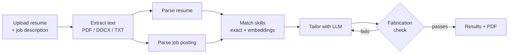

<div align="center">


# FastApply

**Tailor your resume and cover letter to any job posting in about 30 seconds, without the AI making anything up.**

[**Live demo →**](https://fast-apply-sigma.vercel.app)


</div>

<!--
  Add a screenshot of the results view here: run an analysis on the live site,
  take a screenshot (Cmd+Shift+4), save it as docs/screenshot.png, then uncomment:

<p align="center"></p>
-->

## What it does

Upload a resume or cover letter (PDF, DOCX, or TXT), paste a job description, and FastApply gives you:

- **Match score.** How well your skills cover the role, using exact matching plus embedding-based *semantic* matching, so "React.js" counts toward "React".
- **Skill gaps.** The keywords and requirements the posting asks for that your document doesn't mention.
- **An honest rewrite.** Your bullet points (or cover letter paragraphs) rewritten to align with the job, using only what's already true.
- **Recommendations.** Concrete things you could add *if they apply to you*.
- **One-click PDF.** A clean, ATS-friendly export ready to submit.
- **Company research (cover letters).** An optional live web lookup, so the letter can reference something real about the company.

## The interesting part: guarding against hallucinations

LLMs love to "improve" resumes by inventing metrics and technologies. FastApply treats that as a bug:

1. The model is asked to rewrite each bullet **in place**: same count, same order, no new facts.
2. Every rewritten bullet is checked against the original document for **numbers and capitalized terms (technologies, companies, tools) that weren't there before**.
3. If anything is fabricated, the model gets the specific violations as feedback and **retries** (up to 3 attempts).
4. If it still can't produce a grounded rewrite, FastApply **keeps your original bullets** rather than ship something false.

All LLM calls use OpenAI **structured outputs** with Pydantic schemas, so responses are always valid and type-checked.

## How it works



Resume and job parsing run **concurrently** (async OpenAI client + `asyncio.gather`), which cuts response time noticeably.

## Tech stack

| Layer | Tech |
|---|---|
| Frontend | Next.js 16 (App Router), React 19, TypeScript, Tailwind CSS 4 |
| Backend | FastAPI, Pydantic, async OpenAI SDK (Responses API + embeddings) |
| Documents | pypdf, python-docx, ReportLab |
| Infrastructure | Docker and Docker Compose, Vercel (frontend), Render (backend) |
| Quality | pytest (with a fake OpenAI client, so no API key needed), ESLint, per-IP rate limiting, upload limits |

## Project structure

```
backend/
  main.py          FastAPI app, CORS, error handling, /health
  core/            settings (env vars), rate limiting
  routers/         endpoints + upload validation
  services/        parsing, matching, tailoring, verification, PDF generation
  schemas/         Pydantic models (also the LLM output schemas)
  utils/           LLM + embedding helpers, prompts
  tests/           pytest suite
frontend/
  app/             layout, page, icons
  components/      form, results, layout, ui
  lib/api.ts       API client
docker-compose.yml
render.yaml        Render Blueprint for the backend
```

## Running locally

**With Docker:**

```bash
cp backend/.env.example backend/.env    # add your OPENAI_API_KEY
docker compose up --build
```

The frontend runs at http://localhost:3000 and the API docs at http://localhost:8000/docs.

**Without Docker:**

```bash
# Backend
cd backend
python -m venv .venv && source .venv/bin/activate
pip install -r requirements-dev.txt
cp .env.example .env                     # add your OPENAI_API_KEY
uvicorn main:app --reload

# Frontend (new terminal)
cd frontend
npm install
npm run dev
```

**Tests:**

```bash
cd backend && pytest
cd frontend && npm run lint
```

## Configuration

Backend environment variables (see `backend/.env.example`):

| Variable | Default | Purpose |
|---|---|---|
| `OPENAI_API_KEY` | (required) | OpenAI API key |
| `ALLOWED_ORIGINS` | `http://localhost:3000` | Comma-separated frontend origins allowed by CORS |
| `ALLOWED_ORIGIN_REGEX` | none | Extra origins by regex, e.g. Vercel preview URLs |
| `LLM_MODEL` / `RESEARCH_MODEL` | `gpt-4.1-mini` | Models for analysis and company research |
| `EMBEDDING_MODEL` | `text-embedding-3-small` | Model for semantic skill matching |
| `MAX_UPLOAD_MB` | `5` | Upload size limit |
| `RATE_LIMIT_REQUESTS` / `RATE_LIMIT_WINDOW_SECONDS` | `10` / `3600` | Analyses per IP per window |

The frontend reads `NEXT_PUBLIC_API_URL` (optional). Production builds default to the Render backend, and development builds to `localhost:8000`.

## Deployment

- **Backend → Render:** New → Blueprint → select this repo. It uses `render.yaml` and builds `backend/Dockerfile`. Set `OPENAI_API_KEY` and `ALLOWED_ORIGINS` (your Vercel URL).
- **Frontend → Vercel:** import the repo with **Root Directory** set to `frontend`.

## Privacy

Uploaded documents are processed in memory and are **not stored** by FastApply. Their text is sent to the OpenAI API to generate results.

## Roadmap

- [ ] Side-by-side diff of original vs. tailored bullets
- [ ] Save and compare multiple job applications
- [ ] DOCX export
